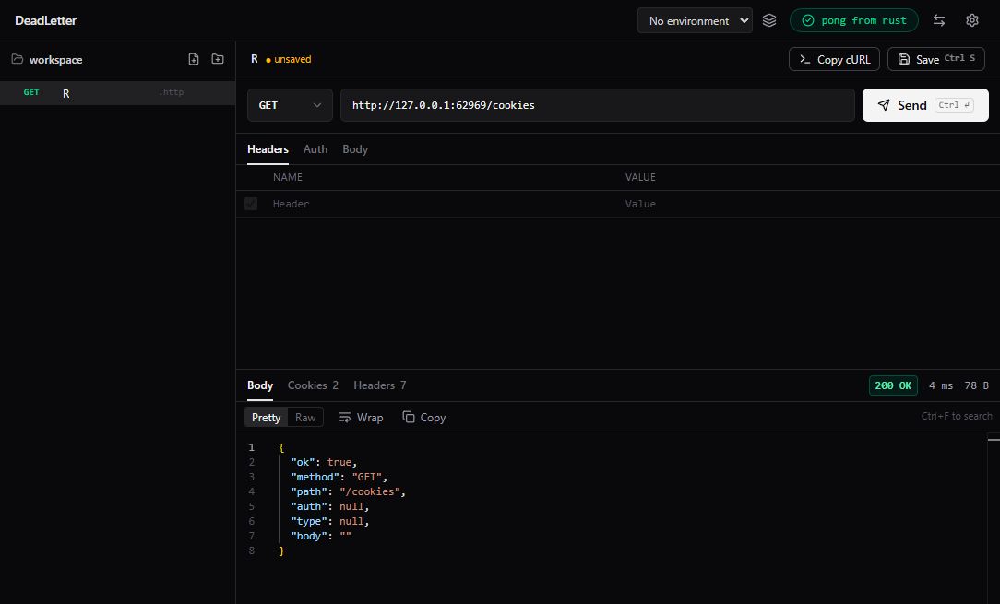

# DeadLetter

A local-first, open-source API client. Your requests are plain files in a folder you choose, so they live in git next to your code. No account, no cloud sync, no telemetry.



- **Files, not a database.** Requests are `.http` (default) or `.json`, one per file, human-readable and diff-friendly.
- **Environments with safe secrets.** `{{variables}}` everywhere; secret values stay in a git-ignored file.
- **Bring your collections.** Import Postman, Insomnia, OpenAPI, Hoppscotch, HAR, Bruno, `.http` files and cURL; export to Postman.
- **Beyond request/response.** Server-Sent Events and WebSocket sessions with a live log.
- **Fast.** The Electron UI stays light; networking, JSON formatting and file watching run in a Rust engine (napi-rs).

**Status:** early but usable. Not there yet: gRPC, scripting, a collection runner. An opt-in MCP server is planned and will always be off by default.

Released under the [MIT license](LICENSE). Contributions welcome, see [CONTRIBUTING.md](CONTRIBUTING.md).

## Development

Prerequisites: Node 20+, pnpm, Rust (stable) + MSVC build tools on Windows.

```sh
pnpm install
pnpm dev          # builds crates/engine (.node), then launches Electron with HMR
pnpm build        # production build of engine + desktop
pnpm typecheck
```

Layout: `apps/desktop` (Electron main/preload/renderer) and `crates/engine` (napi-rs native bindings).

## Collections

Requests live as plain files in a workspace folder you pick (Settings, or the sidebar). Two formats are supported side by side, and Settings chooses which one new requests use:

- `.http` (default), one request per file: `### name`, request line, headers, blank line, body. Disabled headers are written as `# Name: value` comments.
- `.json`: `{ "name", "method", "url", "headers": [{ "name", "value", "enabled" }], "body" }`.

## Environments

Pick an environment in the header, then use `{{variable}}` in a request's URL, headers or body. Environments live in `.deadletter/environments/<name>.json` inside the workspace, so they travel with git. Variables marked secret keep their values in `<name>.secrets.json` next to it; a generated `.gitignore` there keeps that file out of commits. Sending a request that uses an undefined variable fails with a message naming it.

## Import and export

The arrows button in the header opens Import & export:

- **From a file:** Postman (collections, environments), Insomnia (v4 JSON, v5 YAML), OpenAPI 3 / Swagger 2 (JSON or YAML), Hoppscotch, HAR exports from browser dev tools, and `.http` files with several requests (VS Code REST Client, JetBrains; `@var = value` lines become variables). Requests land in a new folder named after the collection (nothing is overwritten) and variables become new environments, secrets kept out of git. OpenAPI path parameters become `{{variables}}` and security schemes become auth headers. Anything that cannot be represented (scripts, multipart bodies, unsupported auth) is listed instead of silently dropped.
- **Bruno folder:** a collection folder (with `bruno.json`) is imported in Bruno's own order. Collection-level headers and auth are applied to requests that inherit them, `:path` params are filled in, and `environments/*.bru` become environments (secret values are never in those files, so they come in empty).
- **From a cURL command:** paste one, including browsers' *Copy as cURL* output (bash or cmd).
- **Export:** the whole workspace as a Postman v2.1 collection, or a single request via **Copy cURL** above the request (variables of the active environment are filled in).

Not supported yet: file uploads (`-F name=@file`, form-data files) and `curl -d @file`.

## Auth and body types

The Auth and Body tabs are editors over plain request data, so files stay portable and nothing new is stored:

- **Bearer / Basic** write the `Authorization` header (`Bearer {{token}}`, `Basic user:pass`). Basic credentials are base64-encoded when the request is sent, the same convention as the VS Code REST Client and JetBrains HTTP Client. Use `{{variables}}` so real credentials stay out of git. API keys are just a header or a query parameter.
- **Form (urlencoded)** writes `Content-Type: application/x-www-form-urlencoded` and a `a=1&b=2` body; `{{variable}}` values are percent-encoded on send.
- **Form-data** writes `Content-Type: multipart/form-data; boundary=...` and the usual boundary-delimited body (text fields; file uploads are not supported yet). Files keep plain line feeds; the engine sends CRLF on the wire.
- **GraphQL** writes `Content-Type: application/json` and the standard `{ "query", "variables" }` envelope. A file in that shape reopens in GraphQL mode.

## Response viewer

Bodies open in a read-only Monaco editor (syntax highlighting, folding, Ctrl+F search) with Pretty/Raw, Wrap and Copy. JSON is pretty-printed by the Rust engine on a worker thread, keeping key order and big numbers intact. The Cookies tab lists every `Set-Cookie` header; Headers shows them all, duplicates included. Monaco loads on first use and runs fully offline.

## Streaming: SSE and WebSocket

No new request type or file format: the request decides how it runs.

- **WebSocket:** a URL starting with `ws://` or `wss://`. Send becomes Connect; the pane below is a live log (received, sent, timestamps) with a message box. Headers are sent with the handshake, and `{{variables}}` work in the URL, headers and outgoing messages. Binary frames are shown as a size only.
- **Server-Sent Events:** any request with an enabled `Accept: text/event-stream` header. Events are parsed by the engine (event name, id, multi-line data) and listed as they arrive; Stop ends the stream. Streams have no overall timeout. If the server answers with something that is not an event stream, its raw chunks are shown instead.

The log keeps the last 5000 entries. Not supported yet: gRPC, a `ws://` URL that only exists after variable substitution (start it with a literal `ws://`), and saving messages with the request.

## Packaging

```sh
pnpm package:win     # NSIS installer      -> apps/desktop/dist/
pnpm package:mac     # dmg
pnpm package:linux   # AppImage
pnpm package:dir     # unpacked app only, fastest way to check a build
```

Each script builds the Rust engine first. The engine is native, so package on the OS you are targeting (cross-packaging is not supported). Nothing is published or signed; builds are unsigned, so Windows SmartScreen and macOS Gatekeeper will warn. electron-builder downloads its Electron and installer tooling from GitHub on the first run.

## Tests

```sh
pnpm test        # Rust unit tests (formats, storage, substitution) and renderer logic tests
pnpm test:e2e    # builds, then drives the real Electron app with Playwright (apps/desktop/e2e)
```

The e2e suite uses temp workspaces and a local HTTP server, needs no browser download, and writes screenshots to `apps/desktop/test-results/` (git-ignored).
